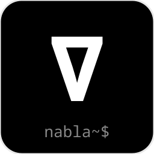

# ∇ Nabla

Navegador minimalista con estética TUI (mono, glass, notch), construido sobre **[Thorium](https://github.com/Alex313031/Thorium)** (fork optimizado de Chromium) — sin compilar nada: todo lo de Nabla es un tema + extensión + políticas + pestaña nueva.



## Qué le cambia a Thorium/Chromium

| Área | Qué hace |
|---|---|
| **Tema negro puro** | `linux/blacktheme/` — tema Chromium MV2: marco, toolbar, pestañas y omnibox en #000. |
| **Extensión Nabla** | `linux/monofont/` — fuente mono configurable en todas las páginas, animación de carga (fade negro), **DuckDuckGo** con pill de tabs glass + notch que persigue el mouse, desbranding de DDG, blur-reveal de resultados, **YouTube minimalista** (panel propio con Subscriptions/You/History/Playlists, buscador recogido "nabla~$ yt", modo cine por defecto, grid a 4 columnas). |
| **Pestaña nueva** | `linux/newtab.html` — barra liquid-glass con estrella ✦ de modo IA (Claude/ChatGPT/Grok/Gemini/Z.ai), typewriter, autocomplete DDG, favoritos, settings (brillo/contraste/glow/color/fuente/modo ligero). |
| **Buscador por políticas** | `linux/policies-nabla.json` — DuckDuckGo fijo + NewTabPageLocation (las preferencias manuales de Chromium se resetean por MACs; políticas no). |
| **Título " - Nabla"** | patch de longitud fija sobre los `.pak` del build (` - Thorium` → ` - Nabla  `). |

## Linux (Fedora, RPM Thorium M156)

```bash
sudo dnf install -y /tmp/opencode/thorium.rpm        # build AVX512 de gz83/thorium M156.0.8078.80
sudo rm -f /usr/share/applications/org.chromium.Thorium.desktop
sudo cp linux/thorium-browser.desktop /usr/share/applications/
mkdir -p ~/.local/share/icons/hicolor/{scalable,256x256}/apps
cp assets/nabla.* ~/.local/share/icons/hicolor/*x*/apps/
sudo cp linux/policies-nabla.json /etc/chromium/policies/managed/nabla.json
cp -a linux/monofont linux/blacktheme ~/.config/nabla/
cp linux/newtab.html ~/.config/nabla/
cp linux/fontconfig.conf ~/.config/fontconfig/fonts.conf   # solo mapea Roboto → JetBrains Mono (no rompe Tilix)
```

Lanzador ligero: `linux/nabla-light.desktop` (`--force-prefers-reduced-motion --disable-smooth-scrolling --enable-low-end-device-mode`).

## Windows (instalador portable)

Descarga **`Nabla_Windows_v1.0.zip`** de [Releases](../../releases) (Thorium AVX2 M156.0.8078.80 con el rebranding ya aplicado):

1. Descomprime el paquete completo (BIN + NABLA juntos).
2. Doble click en `NABLA\INSTALAR_NABLA.bat` (no requiere admin).
3. Lanza "Nabla" desde el Escritorio.

Si tu CPU no soporta AVX2, usa el build SSE4/SSE3 equivalente y corre el mismo `NABLA\INSTALAR_NABLA.bat` encima.

## Cómo probar los estilos en vivo (CDP)

```bash
thorium-browser --force-dark-mode --load-extension=~/.config/nabla/monofont,~/.config/nabla/blacktheme --remote-debugging-port=9222
# tabs: PUT http://127.0.0.1:9222/json/new?<url> (PUT obligatorio); cerrar con /json/close/{id}
```

## Estructura

```
assets/            icono nabla (∇)
linux/
  monofont/        extensión (mono.js · ddg.js/css · yt.js/css · font.css)
  blacktheme/      tema Chromium MV2
  newtab.html      pestaña nueva
  policies-nabla.json
  fontconfig.conf
  *.desktop        lanzadores
```

Base: [Thorium](https://github.com/Alex313031/Thorium) (Chromium 156.0.8078.80). Fuente: [JetBrains Mono](https://www.jetbrains.com/lp/mono/).
